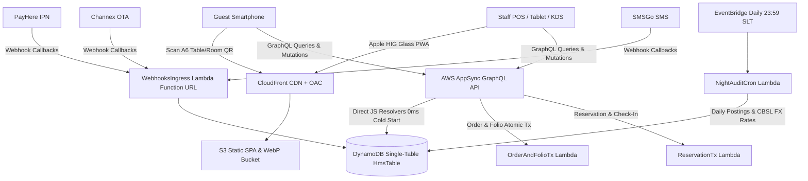

# Sri Lankan Cloud SaaS Hotel Management System (HMS) & QR Platform

[](https://www.typescriptlang.org/)
[](https://react.dev/)
[](https://aws.amazon.com/cdk/)
[](https://biomejs.dev/)
[](https://aws.amazon.com/free/)
[](https://opensource.org/licenses/MIT)

A multi-tenant, serverless Cloud SaaS Hotel Management System purpose-built for Sri Lankan hotels, boutique villas, heritage bungalows, and rest houses. Compliant with Sri Lankan Inland Revenue Department (IRD) statutory 4-stage tax compounding (`SC -> TDL -> SSCL -> VAT`), LankaQR (EMVCo MPM), SLTDA monthly statistical returns, and Sri Lankan NIC/Passport guest registration.

---

## Architecture Overview



### Multi-Repository Structure
- **[`Sri-Lanka--HMS`](https://github.com/PasanRamyanath/Sri-Lanka--HMS)**: Master workspace orchestrator, devcontainer configuration, Antigravity CLI skills, and global verification gates.
- **[`HMS-Backend`](https://github.com/PasanRamyanath/HMS-Backend)**:
  - `packages/core` (`@hms/core`): Pure TypeScript Sri Lankan hospitality domain engine. Zero runtime npm dependencies.
  - `packages/graphql` (`@hms/graphql`): 42-entity AppSync GraphQL schema, 17 bundled JS resolvers, and TypeScript contracts.
  - `packages/cdk` (`@hms/cdk`): AWS CDK v2 serverless stack targeting permanent AWS Free Tier in `ap-south-1` (Mumbai).
- **[`HMS-Frontend`](https://github.com/PasanRamyanath/HMS-Frontend)**: React 19 + Tailwind CSS v4 + Apple Human Interface Guidelines (HIG) Liquid Glass UI across Guest QR PWA, Kitchen/Bar KDS, POS, Tape Chart, and Admin PMS.

---

## 1. Quick Start & Local Development

### Prerequisites
- Node.js 22 LTS
- Git & GitHub CLI (`gh`)
- AWS CLI v2 configured for `ap-south-1`

### Codespaces One-Click Setup
When launching inside GitHub Codespaces, `.devcontainer/bootstrap-three-repos.sh` automatically clones both child repositories:
```bash
# Clone and link child workspaces if working locally
git clone https://github.com/PasanRamyanath/HMS-Backend.git
git clone https://github.com/PasanRamyanath/HMS-Frontend.git

# Install dependencies across all monorepos
npm install --prefix HMS-Backend
npm install --prefix HMS-Frontend
```

### Running Local Development Servers
```bash
# 1. Run Backend Type Checks and Build
cd /workspaces/Sri-Lanka--HMS/HMS-Backend
npm run build --workspaces

# 2. Run Core Tests (1,058 tests passing)
npm test

# 3. Start Frontend Vite Dev Server (Port 5173)
cd /workspaces/Sri-Lanka--HMS/HMS-Frontend
npm run dev
```

---

## 2. Antigravity CLI (`agy`) Skills & Commands

The workspace includes custom agent skills and tools:
- `/goal`: Executes long-running architectural step workflows adhering to `plan.md`.
- `ponytail`: Lazy senior developer anti-bloat principle — minimal robust changes with zero speculative abstractions.
- `apple-design`: Validates Apple HIG compliance, interaction physics, and high-contrast liquid glass tokens.
- `security-auditor`: Verifies HMAC anti-tampering, constant-time comparisons, and multi-tenant isolation.

---

## 3. AWS CDK Deployment & Permanent Free-Tier Governance

The backend is engineered for permanent AWS Free Tier compliance in `ap-south-1` (Mumbai):

| Resource | Free-Tier Allocation | Sri Lanka HMS Usage | Cost Impact |
| :--- | :--- | :--- | :--- |
| **Amazon DynamoDB** | 25 RCU / 25 WCU | Exactly 20 RCU / 20 WCU (`HmsTable` + 2 GSIs) | $0.00 / month |
| **AWS Lambda** | 1,000,000 req / month | Node.js 22 `ARM_64` (Graviton2, 192 MB) | $0.00 / month |
| **Amazon CloudFront**| 1 TB transfer / month | Global edge caching with Origin Access Control (OAC)| $0.00 / month |
| **Amazon Cognito** | 50,000 MAUs | Email, Phone & Multi-Tenant Claims | $0.00 / month |
| **Amazon CloudWatch**| 10 Metric Alarms | 3 Alarms (`LambdaErrors`, `DynamoReadThrottle`, `DynamoWriteThrottle`) | $0.00 / month |
| **VPC NAT Gateways** | 0 (Strict Guardrail) | Zero NAT Gateways or idle VPC endpoints | $0.00 / month |
| **RDS / OpenSearch** | 0 (Strict Guardrail) | Pure Single-Table DynamoDB architecture | $0.00 / month |

### Deploying the Backend Stack
```bash
cd /workspaces/Sri-Lanka--HMS/HMS-Backend/packages/cdk

# Synthesize CloudFormation template
npm run synth

# Run automated cost guardrails test
node --import tsx --test test/cost-guardrails.test.ts

# Deploy stack to ap-south-1
npx cdk deploy SriLankaHmsStack --require-approval never

# Export environment variables for Frontend
node scripts/export-outputs.mjs
```

---

## 4. Webhook Ingress Endpoints & Signatures

The unified `webhooksIngress` function URL accepts automated provider callbacks:

- **PayHere Payment Gateway**: `POST /webhooks/payhere`
  - Signed via uppercase MD5: `MD5(merchant_id + order_id + payhere_amount + payhere_currency + status_code + MD5(merchant_secret))`
- **Channex.io OTA Channel Manager**: `POST /webhooks/channex`
  - Verified with raw-body `HMAC-SHA256` in header `x-hmac-signature-256` within 300s timestamp window.
- **SMSGo.lk SMS Delivery Receipts**: `POST /webhooks/smsgo`
  - Authenticated via `X-SMSGo-Signature` HMAC-SHA256 header.
- **WebXPay Subscription Ingress**: `POST /webhooks/webxpay`
  - Verified via RSA/SHA256 payload verification.

---

## 5. 5-Minute Sri Lankan Hotel Onboarding Runbook

Follow this operational runbook to onboard a new Sri Lankan property:

### Step 1: Provision Hotel Tenant
Run the automated seed script to provision the hotel admin account and baseline configurations:
```bash
cd /workspaces/Sri-Lanka--HMS/HMS-Backend/packages/cdk
node scripts/seed-first-hotel.mjs
```

### Step 2: Configure Sri Lankan 4-Stage Tax Rates
In the Admin Portal (`/settings/taxes`), select the statutory tax tier:
- **Registered City Hotels & Resorts (Default)**:
  - Service Charge: `10.0%`
  - Tourism Development Levy (TDL): `1.0%`
  - Social Security Contribution Levy (SSCL): `2.5%`
  - Value Added Tax (VAT): `18.0%`
  - Formula: `Gross = Base × 1.10 × 1.035 × 1.18 = Base × 1.34343`
- **Small Guest House Tier (Under LKR 12M turnover)**:
  - TDL: `0.5%`
  - SC, SSCL, VAT: `0.0%`

### Step 3: Print Contactless Room & Table QR Stands
1. Navigate to **Admin PMS > QR Management > Generate Stands**.
2. Download the high-resolution vector SVGs (300 DPI for standard A6 acrylic table tents).
3. Each QR encodes a cryptographically signed HMAC-SHA256 session token with a 72-hour rolling expiration:
   - `Room 101` .. `Room 108`
   - `Restaurant Table T-01` .. `T-10`
   - `Pool Cabana C-01` .. `C-04`
4. Guests scan to order directly without downloading an app or logging in.

### Step 4: Configure Driver Quarters & Tour Guide Facilities
Under **Room Inventory > Driver Quarters**:
- Enable complimentary driver accommodations or standard SLTDA driver rate (`Rs. 1,500/night`).
- Record driver national identity card (NIC) and vehicle registration number for Tourist Police compliance.

### Step 5: Monthly SLTDA Returns & RAMIS Tax Export
At the end of each calendar month:
1. Open **Reports > SLTDA Monthly Statistical Return**.
2. Export the official SLTDA PDF/CSV with foreign vs. resident guest night breakdowns.
3. Export the IRD RAMIS-compliant Schedule 5 VAT and SSCL tax return summary.

---

## 6. Code Quality Gates & Compliance

Before any pull request or deployment is approved, the following gates must report zero errors:

```bash
# 1. Biome Linter & Code Formatter
npx biome check .

# 2. Knip Dead Code & Unused Export Eliminator
npx knip

# 3. Full Cross-Monorepo Verification Suite
./scripts/verify-all-repos.sh
```

- **Zero Console / Debugger Noise**: `suspicious.noConsole: 'error'` enforced across all packages.
- **Typed Results**: Pure domain engine functions return `Result<T, DomainError>`.
- **Immutable Audit Log**: Every financial and room-status mutation appends an SHA-256 hash-chained `ImmutableAuditLog` entry.

---

## License

This project is licensed under the [MIT License](LICENSE).
